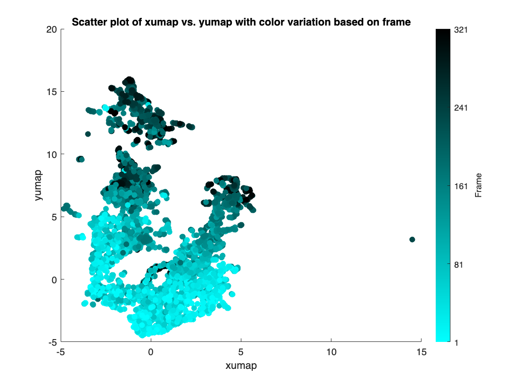
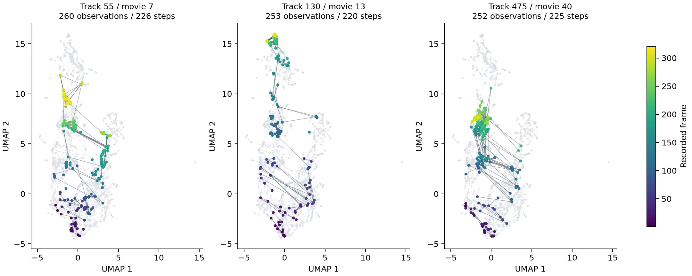
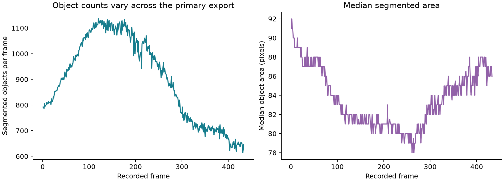

# Cell state dynamics

An image-analysis project from my time in Nan Hao's lab at UC San Diego, working with Sam. The question behind the plots is simple: **how do individual cells change over time, and what can we see when we follow their image-derived features?**

The work here centers on MATLAB: inspecting a supplied UMAP embedding, coloring observations by frame and fluorescence, and exploring individual trajectories and regional direction plots. A separate workflow extracts nucleus measurements from time-lapse images.



*The saved figure from the original MATLAB Live Script. Each point is an observation at one frame; the same tracked cell can appear many times.*

## What's here

- **6,399 observations across 48 track IDs** in a supplied embedding, covering 23 movie IDs and frame numbers 1–321. These IDs map to 41 movie/track combinations, so they are not a verified count of independent cells.
- **MATLAB working scripts** for scatter plots, fluorescence views, trajectory arrows, regional summaries, and nucleus feature extraction.
- **A reproducible Python review** of the available data, added when organizing this repository. It creates the figures below and checks track/frame consistency.

The UMAP coordinates and feature table were supplied to the analysis. This repository does not train a UMAP model or a variational autoencoder. The broader research work was collaborative; the upstream `ictrack` package is not included or presented as my own software.

## Following a track



These are the three most-observed tracks from distinct movie/track combinations, with ties resolved by track ID. Arrows connect consecutive frames within a track; gaps are left unconnected. They show changes in the **embedding**, not physical movement across a microscope image. Color shows the recorded frame number, not a verified biological age.

## Checking the image measurements



The primary segmentation export contains **389,233 segmented-object observations over 433 frames**. Its `Cell ID` is assigned separately within each frame, so this is not a count of unique cells and cannot be used as a longitudinal tracking key.

One alternate export repeats the exact same set of 792 objects in all 433 frames. It is excluded from the figures and published data. See the [data and method notes](docs/data-and-methods.md) for the checks and remaining limitations.

## Run the review

```bash
python -m venv .venv
source .venv/bin/activate
pip install -r requirements.txt
python analyze.py
python -m unittest test_analysis.py
```

The Python review uses the included data and regenerates `figures/track_examples.png`, `figures/segmentation_summary.png`, and `figures/umap_overview.png`. The original MATLAB figure is preserved separately.

For the MATLAB embedding scripts:

```matlab
data = readtable('data/cell_observations.csv');
run('matlab/region.m');
```

Most scripts use a `data` table already in the workspace. The scripts that load a file directly need their input filename pointed to the included CSV. The nucleus workflow additionally requires the original TIFF stack and MATLAB Image Processing Toolbox; the images are not included. Some exploratory scripts use `datasample` or `randsample` from Statistics and Machine Learning Toolbox. MATLAB execution has not been revalidated for this repository.

## Reading the results

This is exploratory analysis. There are no validated aging-mode labels, model-accuracy claims, or causal conclusions here. The original scripts contain working assumptions and a few edge cases, documented in the [notes](docs/data-and-methods.md). The Python review makes its filtering explicit rather than treating every arrow as a biological result.
